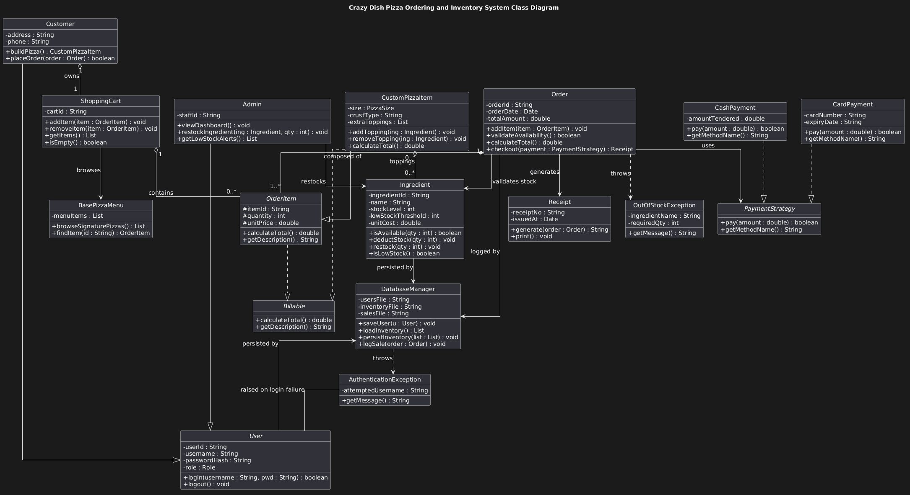
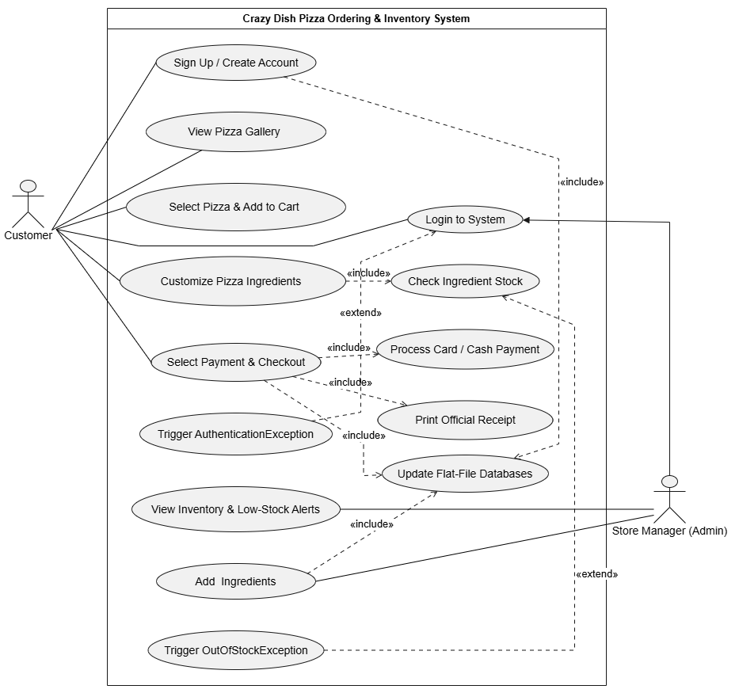

# Crazy-dish-Pizza-Centre


## 📌 Project Overview

Crazy Dish Pizza Centre is a Java Swing desktop application that simulates pizza ordering and topping inventory management. Customers can browse the menu, customize pizzas, and place orders. Store administrators can manage topping prices and stock from a dedicated dashboard.

## 🛠️ Technology Stack

| Technology | Purpose |
| --- | --- |
| Java 21 | Application logic and object-oriented models |
| Java Swing | Desktop user interface |
| Apache Maven | Build and compilation |
| Local text files | Account, inventory, and sales storage |

## ✨ Key Features

### 👤 Customer Accounts

- Register with a username, password, full name, and 10-digit phone number.
- Sign in to browse the menu and start an order.

### 🍕 Pizza Menu & Customization

- Browse Classic Margherita, Smoky BBQ Chicken, Pepperoni Feast, and Garden Veggie Supreme.
- Choose Regular or Large and add available extra toppings.
- Add or remove pizzas and review the cart total in LKR.

### 💳 Checkout & Receipts

- Choose cash on delivery or a simulated credit or debit card payment.
- Check topping availability before confirming an order.
- View and print the receipt after checkout.

### 📦 Inventory & Sales

- Add or restock toppings and update their prices through the admin dashboard.
- View low-stock alerts when a topping has fewer than five units remaining.
- Automatically deduct selected topping quantities after checkout and record the sale in `sales_report.txt`.

## 🚀 Getting Started

### Prerequisites

- JDK 21
- Apache Maven
- A desktop environment that can open Swing windows

### Clone and Run

```bash
git clone https://github.com/theekshanavidanapathirana-commits/Crazy-dish-Pizza-Centre.git
cd Crazy-dish-Pizza-Centre/CrazyDishPizzaCentre
mvn compile
java -cp target/classes gui.PizzaWebAppSimulator
```

Run the last command after Maven reports `BUILD SUCCESS`. Launch the app from the `CrazyDishPizzaCentre` directory so it can find its menu images and data files.

### 🧪 Try the Application

| Role | How to try it |
| --- | --- |
| Customer | Register a sample account, add a pizza to the cart, choose a size and toppings, and check out with **Cash on Delivery**. |
| Administrator | Sign in with the bundled demo username `admin` and password `admin123` to open the inventory dashboard. |

Use sample account details and test card numbers. The app stores passwords in plain text and simulates card payments.

## 📂 Project Structure

| Path | Purpose |
| --- | --- |
| `CrazyDishPizzaCentre/pom.xml` | Maven build configuration |
| `CrazyDishPizzaCentre/src/main/java/gui/` | Swing screens and application entry point |
| `CrazyDishPizzaCentre/src/main/java/model/` | Pizza, order, ingredient, user, and payment classes |
| `CrazyDishPizzaCentre/src/main/java/service/` | Billing and payment interfaces |
| `CrazyDishPizzaCentre/src/main/java/exception/` | Authentication and stock exceptions |
| `CrazyDishPizzaCentre/src/main/java/util/` | Local file storage |
| `CrazyDishPizzaCentre/images/` | Pizza menu images |
| `CrazyDishPizzaCentre/users.txt` | User accounts and roles |
| `CrazyDishPizzaCentre/inventory.txt` | Topping prices and stock quantities |
| `CrazyDishPizzaCentre/sales_report.txt` | Sales records |

## 📐 UML Diagrams

<details>
<summary>Class Diagram</summary>



</details>

<details>
<summary>Use Case Diagram</summary>



</details>
